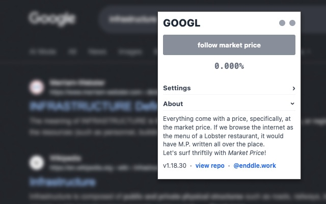

# Market Price

> *This browser extension searches for the current viewing webpage's company's stock symbol and its latest price, notifies the user by alternating the content and appearance of the page. The market price occupies every price tag on the webpage, every update triggers a flash of color corresponding to the rising and falling trend, and an automated page scroll by the fluctuating percentage.*

Stock market is an essential piece of infrastructure of today’s economical system. According to Susan Leigh Star’s definition of infrastructure, it “[b]ecomes visible upon breakdown” (Star 1999, 382), so as the stock market. People remembers the financial crisis of 2008, but for those who are not working or investing in the market, it is hard to keep up with the always fluctuating and floating prices. Unless the stock market stopped functioning, its impacts and qualities stay largely obscured. Instead of breaking the market, this project takes another direction, through an intervention of everyday browsing.
 
The fluctuation in prices and changes intrude the webpage by replacing every visible price tag, forcing browsers (people & software) to keep track of stock prices. The passive and constant tracking breaks the order of our online experience, creating a situation where the stock market is visible, and even a disruptive device of our digital life – a first step towards questioning and discussing it.

Why should we care about stock market? Other than investing in trading stocks, the market is also one of the fundamental driving forces of the entire economic system. The accumulative changes in negligible percentage affect not only the rankings of the net worth of billionaires, but also the financial and management decisions of corporates, sitting investors, stakeholders, employees, and users of their products in the same boat. Through public campaigns and lobbying, the impact may ends up influencing the public opinion and policymaking, reaching far beyond related parties, communities, even a state. It’s no exaggeration to say that the future of all mankind is tied to those bouncing digits of percentage.

Then why is the price tag we see static? Everything comes with a price, specifically, the market price. If we browse the internet as the menu of a Lobster restaurant, it would have M.P. written all over the place.

Let’s surf thriftily with *Market Price*!

### Reference

Star, Susan Leigh. “The Ethnography of Infrastructure.” American Behavioral Scientist 43, no. 3 (1999): 377–91. https://doi.org/10.1177/00027649921955326. 
